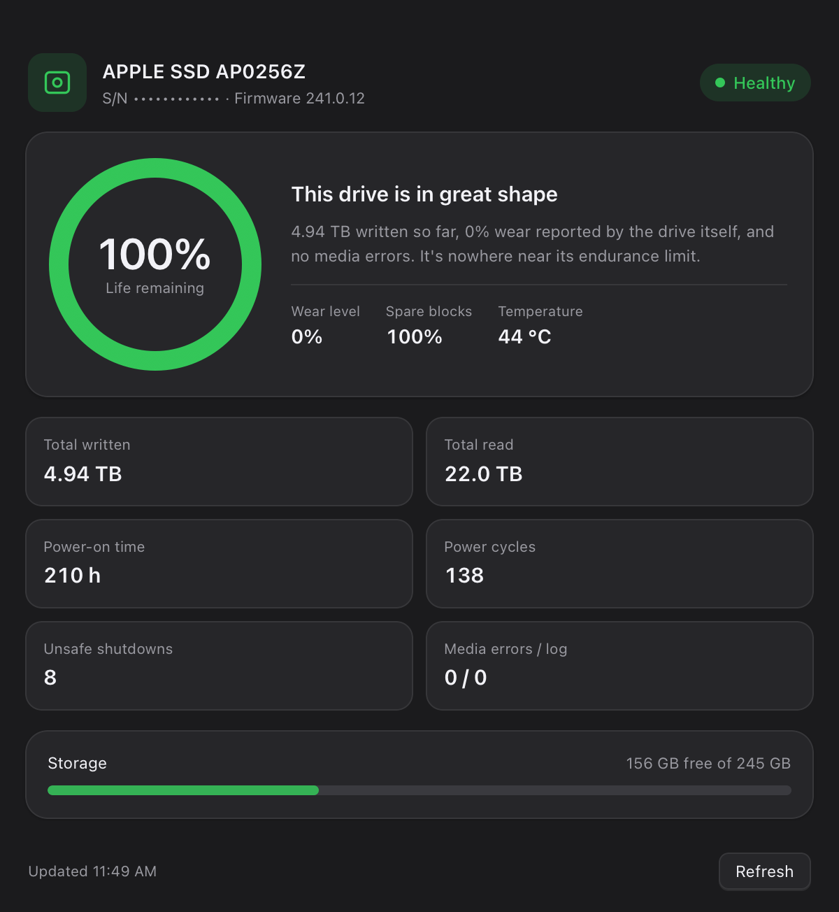

<div align="center">

# Disk Health

**A tiny macOS app that reads your Apple SSD's real NVMe SMART health — wear level, terabytes written, power-on hours — in one glance.**

English · [简体中文](README.zh-CN.md)


</div>

---

macOS's Disk Utility only tells you `SMART: Verified`. It never shows how much of the SSD's life you have actually used. Disk Health reads the NVMe **SMART / Health Information log page (0x02)** straight from the drive and shows the numbers the controller reports about itself.

## Features

- **Wear ring** — remaining life based on the drive's own `Percentage Used` counter
- **Lifetime counters** — total bytes written/read, power-on hours, power cycles, unsafe shutdowns, media errors
- **Storage bar** — free vs. total on the boot volume
- **Bilingual UI** — follows your system language (English / 简体中文)
- **Light & dark** — follows the system appearance
- **100% local** — no network access, no telemetry, no data leaves the machine
- **Tiny** — ~370 KB app, no third-party dependencies

<p align="center">
  
  
</p>

## Requirements

- macOS 13 or later
- Apple Silicon (arm64)
- An Apple-built internal SSD (the only NVMe device that exposes the SMART user client)

## Install

Download or build `DiskHealth.app` and drag it into `/Applications`.

The app is **ad-hoc signed**, not notarized. It runs fine when built on your own Mac. If you copy it to another Mac, Gatekeeper will complain — right-click → **Open**, or build it from source there.

## Build from source

```bash
git clone https://github.com/editwe/disk-health.git
cd disk-health
./build.sh          # produces build/DiskHealth.app
open build/DiskHealth.app
```

Requires the Xcode Command Line Tools (`clang`, `swiftc`, `sips`, `iconutil`). No Xcode project, no package manager, no network.

## How it works

```
┌────────────────────┐   IOKit    ┌──────────────────────────────┐
│ HealthReader.c     │───────────▶│ NVMeSMARTLib.plugin          │
│ (C, JSON out)      │            │ /System/Library/Extensions   │
└─────────┬──────────┘            └──────────────┬───────────────┘
          │ JSON                                 │ SMARTReadData()
          ▼                                      ▼
┌────────────────────┐            ┌──────────────────────────────┐
│ AppDelegate.swift  │            │ SSD controller               │
│ AppKit + WKWebView │            │ (log page 0x02)              │
└─────────┬──────────┘            └──────────────────────────────┘
          │ window.render(data, meta)
          ▼
┌────────────────────┐
│ index.html         │
│ HTML / CSS / JS    │
└────────────────────┘
```

- `HealthReader.c` matches IORegistry services advertising `NVMe SMART Capable`, creates a user client through Apple's `NVMeSMARTLib.plugin`, and calls `SMARTReadData()`.
- `AppDelegate.swift` is a plain AppKit shell (window, menus, language detection) hosting a `WKWebView`.
- `index.html` renders the report and animates the ring with a CSS `conic-gradient`.
- A small debug hook lets the README screenshots be generated deterministically: `DH_SNAPSHOT=/path/out.png` renders once and quits, `DH_LANG=zh|en` forces a language, `DH_REDACT=1` masks the serial number.

## What the numbers mean

| Field | Meaning |
|---|---|
| `Percentage Used` | Vendor wear counter, 1% granularity. `0%` means less than 1% of rated endurance consumed. |
| `Available Spare` | Remaining spare blocks, as a percentage of the spare pool. |
| `Data Units Written` | Lifetime host writes. One unit = 512,000 bytes (1000 × 512 B). |
| `Data Units Read` | Lifetime host reads, same unit. |
| `Power On Hours` | Total powered-on time reported by the controller. |
| `Power Cycles` | Number of power on/off cycles. |
| `Unsafe Shutdowns` | Power losses without a proper shutdown. |
| `Media Errors` | Unrecovered data integrity errors — should be `0`. |

> Note: `Percentage Used` is an integer counter, so a nearly-new drive usually reads `0%` until it crosses the first percent.

## Project layout

| Path | Purpose |
|---|---|
| `src/HealthReader.c` / `.h` | IOKit → NVMe SMART → JSON |
| `src/AppDelegate.swift` | Window, menu, language, WKWebView host |
| `src/main.swift` | Entry point |
| `src/index.html` | UI (HTML/CSS/JS, zh + en strings) |
| `src/Info.plist`, `src/*.lproj` | Bundle metadata and localized names |
| `src/icon_1024.png`, `src/make_icon.py` | Icon artwork |
| `build.sh` | One-command build |

## Limitations

- **Internal Apple SSDs only.** External drives and USB enclosures don't expose this user client.
- The app is not sandboxed (it needs IOKit access) and is not notarized.
- Only one process can hold the SMART user client at a time; launching two instances at once makes the second one show "Unavailable" — refresh once the other quits.
- The SMART user client may be unavailable on some macOS versions; the app then shows a friendly error instead of crashing.

## License

[MIT](LICENSE) — do whatever you like.
