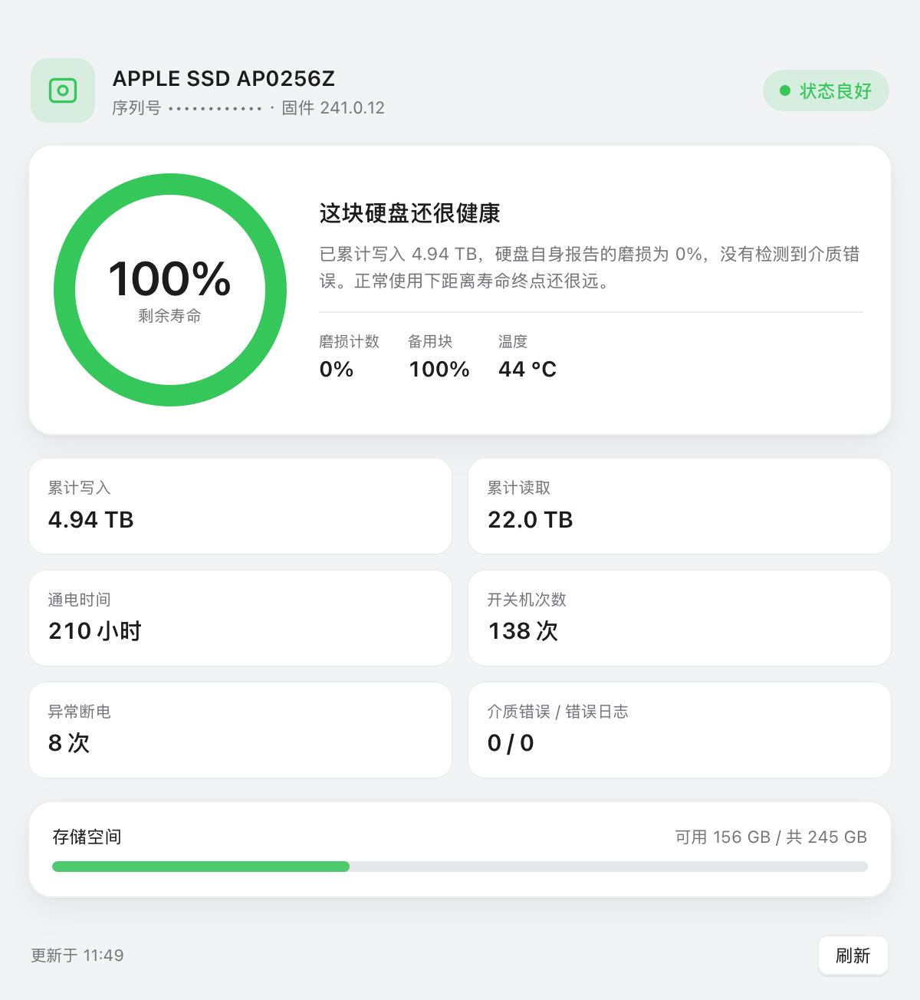
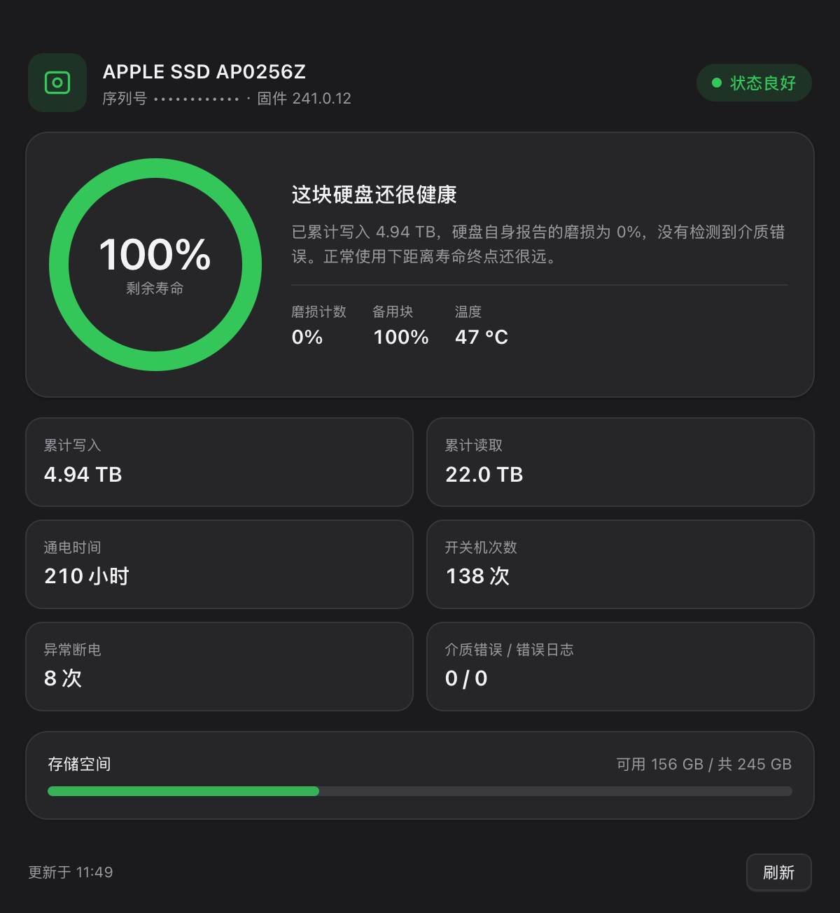
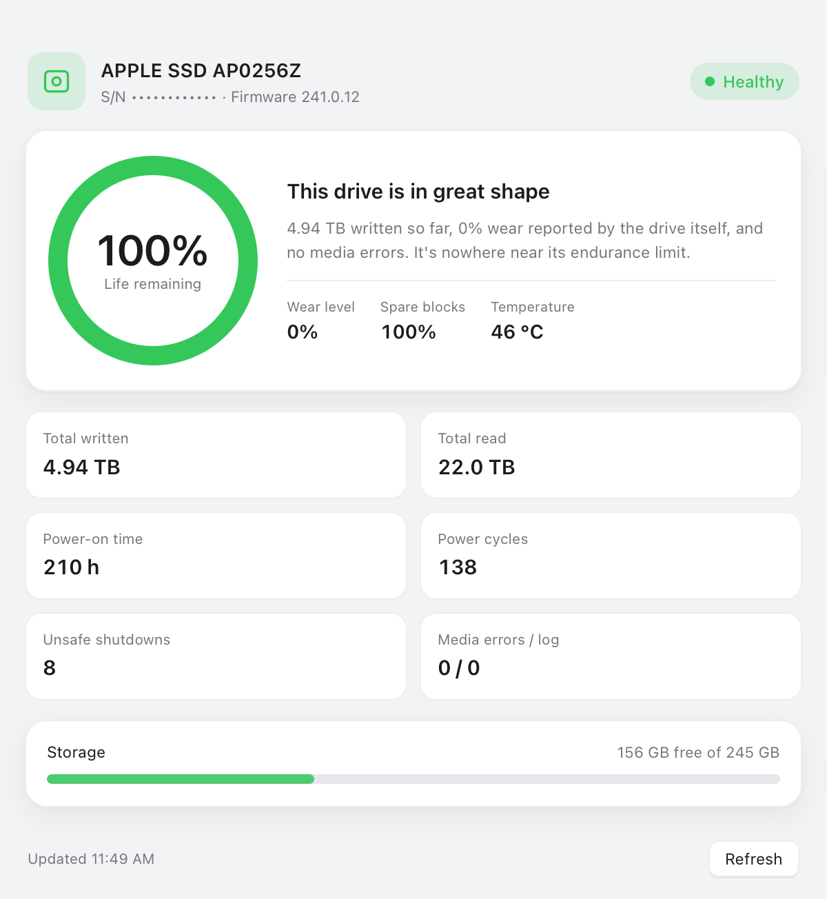

<div align="center">

# 硬盘健康 · Disk Health

**一个极小的 macOS 应用，一眼看清 Apple 内置 SSD 的真实 NVMe SMART 健康度 —— 磨损、累计写入、通电时间。**

[English](README.md) · 简体中文




</div>

---

macOS 的「磁盘工具」只会告诉你 `SMART: Verified`，从不显示这块 SSD 到底用掉了多少寿命。硬盘健康直接读取 NVMe 的 **SMART / Health Information 日志页（0x02）**，把主控自己上报的数据展示出来。

## 功能

- **寿命圆环** —— 基于硬盘自身的 `Percentage Used` 磨损计数计算剩余寿命
- **终身计数** —— 累计写入 / 读取、通电时间、开关机次数、异常断电、介质错误
- **存储空间条** —— 启动卷的已用 / 总量
- **中英双语界面** —— 跟随系统语言（简体中文 / English）
- **深浅色自适应** —— 跟随系统外观
- **完全本地** —— 不联网、无遥测、数据不出本机
- **体积小** —— 约 370 KB，零第三方依赖

<p align="center">
  
  
</p>

## 系统要求

- macOS 13 及以上
- Apple Silicon（arm64）
- Apple 原厂内置 SSD（目前唯一暴露 SMART 用户客户端的 NVMe 设备）

## 安装

下载或自行构建 `DiskHealth.app`，拖进 `/Applications` 即可。

应用采用 **ad-hoc 签名**，未经过公证。在你自己机器上构建的可直接运行；拷到别的 Mac 上会被 Gatekeeper 拦截 —— 右键 →「打开」，或在那台机器上重新构建。

## 从源码构建

```bash
git clone https://github.com/editwe/disk-health.git
cd disk-health
./build.sh          # 生成 build/DiskHealth.app
open build/DiskHealth.app
```

依赖 Xcode Command Line Tools（`clang`、`swiftc`、`sips`、`iconutil`）。没有 Xcode 工程、没有包管理器、不联网。

## 工作原理

```
┌────────────────────┐   IOKit    ┌──────────────────────────────┐
│ HealthReader.c     │───────────▶│ NVMeSMARTLib.plugin          │
│ （C，输出 JSON）    │            │ /System/Library/Extensions   │
└─────────┬──────────┘            └──────────────┬───────────────┘
          │ JSON                                 │ SMARTReadData()
          ▼                                      ▼
┌────────────────────┐            ┌──────────────────────────────┐
│ AppDelegate.swift  │            │ SSD 主控                     │
│ AppKit + WKWebView │            │ （日志页 0x02）              │
└─────────┬──────────┘            └──────────────────────────────┘
          │ window.render(data, meta)
          ▼
┌────────────────────┐
│ index.html         │
│ HTML / CSS / JS    │
└────────────────────┘
```

- `HealthReader.c` 在 IORegistry 中匹配声明了 `NVMe SMART Capable` 的服务，通过 Apple 自带的 `NVMeSMARTLib.plugin` 创建用户客户端，调用 `SMARTReadData()`。
- `AppDelegate.swift` 是纯 AppKit 外壳（窗口、菜单、语言判断），内部承载一个 `WKWebView`。
- `index.html` 负责渲染，用 CSS `conic-gradient` 画寿命圆环。
- 内置一个调试钩子，让 README 截图可复现：`DH_SNAPSHOT=/path/out.png` 渲染一次即退出，`DH_LANG=zh|en` 强制语言，`DH_REDACT=1` 隐藏序列号。

## 字段含义

| 字段 | 含义 |
|---|---|
| `Percentage Used` | 厂商磨损计数，1% 粒度。`0%` 表示已消耗寿命不足 1%。 |
| `Available Spare` | 剩余备用块占备用池的百分比。 |
| `Data Units Written` | 终身主机写入量，1 单位 = 512,000 字节（1000 × 512 B）。 |
| `Data Units Read` | 终身主机读取量，单位同上。 |
| `Power On Hours` | 主控统计的通电总时长。 |
| `Power Cycles` | 开关机次数。 |
| `Unsafe Shutdowns` | 非正常关机 / 断电次数。 |
| `Media Errors` | 无法恢复的数据完整性错误，正常应为 `0`。 |

> 注意：`Percentage Used` 是整数计数器，接近全新的硬盘通常显示 `0%`，直到跨过第一个百分点。

## 目录结构

| 路径 | 作用 |
|---|---|
| `src/HealthReader.c` / `.h` | IOKit → NVMe SMART → JSON |
| `src/AppDelegate.swift` | 窗口、菜单、语言、WKWebView 宿主 |
| `src/main.swift` | 程序入口 |
| `src/index.html` | 界面（HTML/CSS/JS，中英文案） |
| `src/Info.plist`、`src/*.lproj` | 包元数据与本地化名称 |
| `src/icon_1024.png`、`src/make_icon.py` | 图标原图与生成脚本 |
| `build.sh` | 一键构建 |

## 已知限制

- **只支持 Apple 内置 SSD**。外置硬盘、USB 硬盘盒不会暴露这个用户客户端。
- 应用未启用沙盒（需要 IOKit 权限），也未公证。
- SMART 用户客户端同一时间只能被一个进程占用；同时开两个实例时，第二个会显示「无法读取」，关掉另一个再刷新即可。
- 部分 macOS 版本可能不提供该用户客户端，此时应用会显示友好的错误提示而不是崩溃。

## 许可证

[MIT](LICENSE)，随便用。
